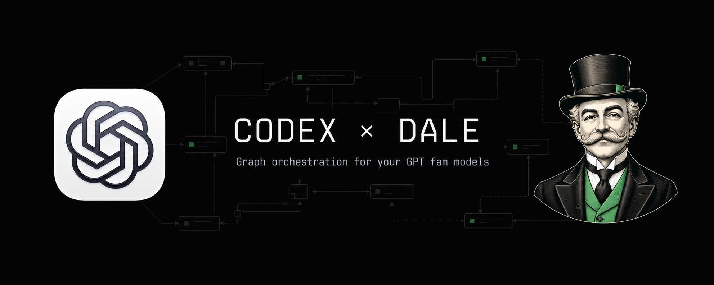

# Dale



A focused toolbox for Codex: think through a direction, map a repository,
delegate independent work, verify the result, and resume work when needed.

## Install and update

```sh
curl -fsSL https://borkiss.net/dale-install.sh | sh
```

Run `dale` for the interactive skill picker. For an existing installation:

```sh
dale update --yes
dale list --json
```

Restart Codex after updating. The updater supports plugin-cache and standalone
skill installations and preserves the previous plugin version for rollback.
Headless options and the installer implementation are documented in
[tui/README.md](tui/README.md). Updating skills does not require replacing your
global `AGENTS.md`. The default updater follows upstream `main`. To preserve
this fork's adaptations, refresh the native plugin from this checkout or use a
fork payload through `--update-url`; keep one canonical installed copy.

## Execution in 0.5

Dale uses the calling agent and subagents by default. Delegate when a work unit
can progress independently and saves time or supplies meaningful independent
evidence. Small or tightly coupled work usually stays local. Explicit `$dale-max`
and `$dale-cross` runs make the coordinator the planner and orchestrator: for
substantial work, delegate useful independent work, integrate accepted artifacts,
and verify the final target. The coordinator keeps orchestration and tiny
corrections local.

| Need | Execution |
|---|---|
| Small or sequential work outside Max/Cross | Calling agent |
| Substantial work in Max/Cross; independent implementation or evidence elsewhere | Bounded subagents |
| Explicitly requested separate task, fork, or durable handoff | Codex task tools |
| Requested future observation or continuation | Product automation with durable state |

This fork retains task-matched Luna/Sol routing for Brainstorm evidence and
Index, Terra/Sol routing for Max, and Luna Max for Coach.
Explicit user settings take priority; the live dispatch schema determines
supported models, efforts, and context modes. Other direct work and loop
workers inherit their settings unless an explicit route is requested.

Each worker has an observable output, minimal inputs, a read/write boundary,
and an evidence requirement. One mutating worker runs per shared checkout,
including disjoint files; read-only work may run concurrently. Separate worktree
isolation requires a user request. The coordinator schedules
one delegation level by default and checks the integrated result.

## Skills

| Skill | Purpose |
|---|---|
| `$dale-brainstorm` | Explore ideas and tradeoffs in conversation; converge or implement when asked |
| `$dale-coach` | Inspect selected recent task history and suggest evidence-backed workflow improvements |
| `$dale-lenses` | Reframe a bounded hard question through a useful falsifiable model |
| `$dale-index` | Create or incrementally refresh six repository knowledge primitives |
| `$dale-max` | Complete consequential work with independent review and evidence-based acceptance |
| `$dale-cross` | Choose models per needed role and coordinate Claude, GPT, and Gemini subagents |
| `$dale-proof` | Verify a technical claim within an explicit evidence boundary |
| `$dale-visualize` | Create a self-contained HTML explanation or interactive artifact |
| `$dale-loop-pr` | Monitor or repair a PR within the requested scope |
| `$dale-loop-watch` | Notify or act on meaningful source changes |

Select a skill in Codex or name it in your request. Coach and Max remain
explicit-invocation workflows. Each skill is independently installable; local
references belong to that skill and do not require another Dale skill.

Cross discovers executable models from T3 Code's live composer catalog,
proposes only the roles the task needs, and asks you to choose a model for each
before dispatch. Current-generation choices follow the available catalog rather
than a fixed model list. Your choices override automatic Dale routes for that
task; unavailable selections require a new choice. It can run alone or supply
the routes for an explicitly requested Max workflow. Cross-provider execution
requires T3 child-task support; native subagents alone do not establish it.

## Repository knowledge

Index completes or refreshes an established primitive directory in place,
or starts a new set in the repository root:

- `REQ.md`: intent, scope, requirements, acceptance criteria.
- `CONTEXT.md`: architecture, contracts, repository map, operations.
- `STATE.md`: current work, blockers, risks, next actions.
- `TDD.md`: actual test strategy, commands, quality gates, coverage gaps.
- `DESIGN.md`: existing UI language and states, or explicit non-applicability.
- `DECISIONS.md`: evidenced decisions, alternatives, consequences, and dates.

An incremental refresh checks changed claims and affected consumers, including
uncommitted work. Missing baselines trigger broader inspection. Discovery is
read-only; the coordinator writes and checks the final documents. There is no
mandatory worker count or saved-project requirement.

## Evidence and lifecycle

Max retains independent review as an acceptance gate. The coordinator plans,
integrates, and verifies; bounded subagents handle substantial implementation.
Additional reviewers need a concrete uncovered risk. If independence is
unavailable, useful work can continue but the Max gate cannot be reported as
passed. Review and testing stop when the
required evidence is sufficient; changed artifacts invalidate affected evidence.

Proof distinguishes declared, implemented, tested, and observed behavior. A
worker's completion message or green local checks alone do not prove a deployed
or integrated result. Report what changed, decisive evidence, and limitations;
full orchestration ledgers are available when requested.

Loop PR and Loop Watch persist source identities, actions, evidence, and next
conditions. They re-observe on wake and do not assume subagents survive between
runs. Unchanged monitoring stays quiet. Existing user authorization persists;
the workflow does not invent authority for publication, merge, deployment, or
external messages.

## Fork routing and compatibility

Adapted from upstream commit
[`8c7068d`](https://github.com/lubluniky/dale/commit/8c7068d11c18e60e57e5c8a1b76524a9bf0d8c0d).
The fork keeps its established routes. Explicit user settings take priority;
Cross retains user-selected per-role routes and does not implicitly invoke Max:

| Route | Model ID | Reasoning |
|---|---|---|
| Luna standard | `gpt-6-luna` | `high` for bounded discovery and narrow checks |
| Luna deep | `gpt-6-luna` | `high` or `max` for coupled work and normal proof |
| Max standard | `gpt-6.1-terra` | `high` for bounded work and narrow checks |
| Max deep | `gpt-6.1-terra` | `high` or `max` for implementation and normal proof |
| Sol | `gpt-6.1-sol` | `high` for difficult synthesis; higher effort needs a concrete reason |
| Coach | `gpt-6-luna` | `max` for evidence-backed retrospectives |

When the Max coordinator runs on Claude, Max routes Terra to
`claude-sonnet-5-5` and Sol to `claude-opus-5-5`, mapping `high` to `medium`
and `max` to `high`; `high` is the Claude ceiling.

Show a workload-specific routing reason before dispatch. Never inherit elevated
Sol effort merely because the coordinator uses it. Explicit separate-task mode
retains stable dispatch identities, exact returned IDs, and fail-closed handling
of ambiguous creation. A `clientThreadId` is not a real `threadId`; task listings
cannot prove absence or justify recreating uncertain work.

The linked code walkthrough remains intact: source-scoped before/after snippets,
rationale, connected execution/data flow, selectable graph branches, collapsible
groups, and Previous/Next navigation. Visualizations are checked in a browser;
static checks alone do not establish their runtime behavior.

## Validation

Validate skill frontmatter and references, then exercise realistic scenarios:
small direct changes, independent work with a shared contract, incremental
indexing, unavailable review, monitoring-only requests, and mid-run corrections.
Compare correctness, rework, unnecessary questions, elapsed time, and usage when
available. Static validation alone does not establish speed or cost improvements.

## License

Dale is licensed under the [Mozilla Public License 2.0](LICENSE).
Bundled third-party examples retain their source license notices.
