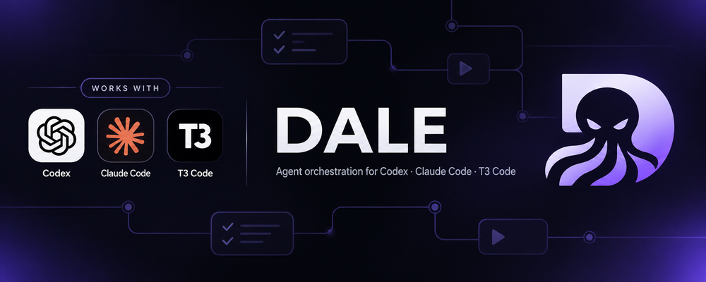
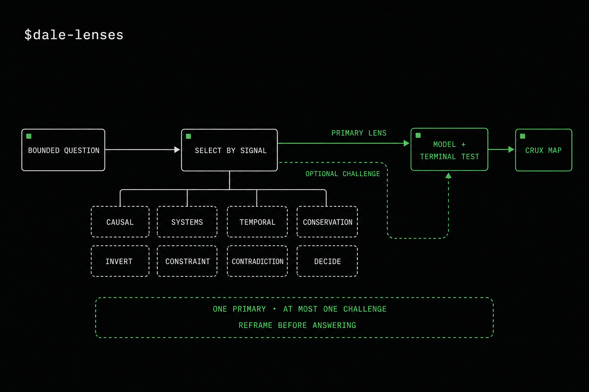
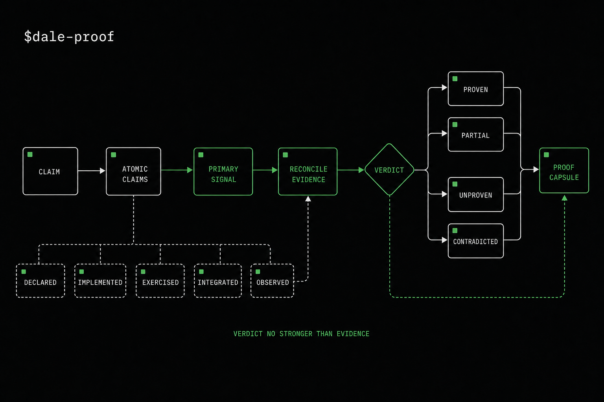
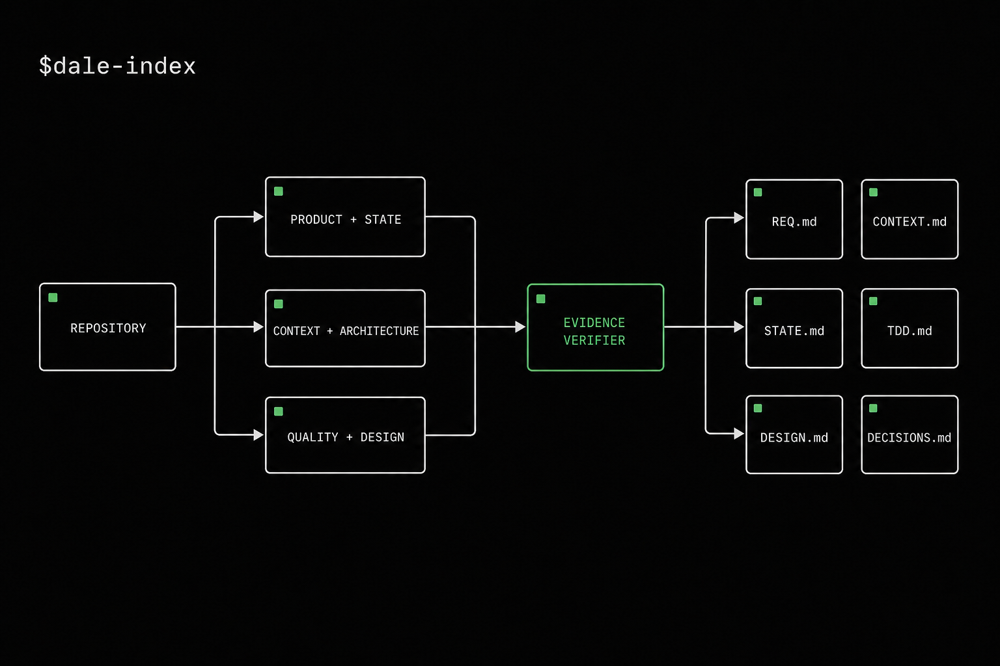
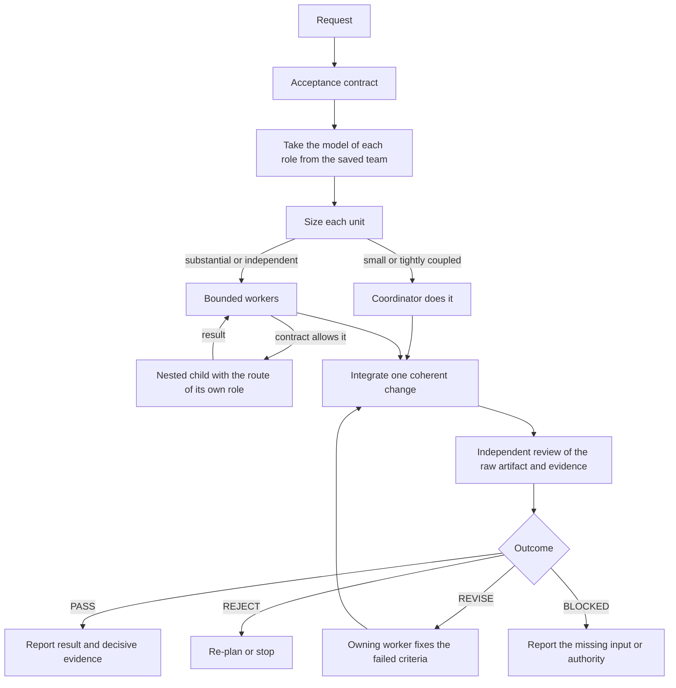
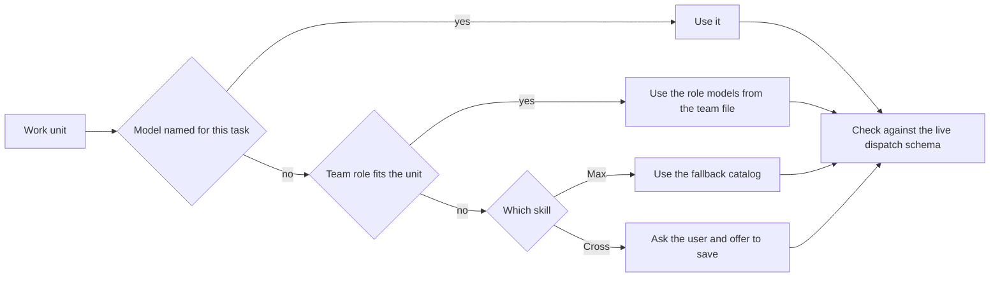
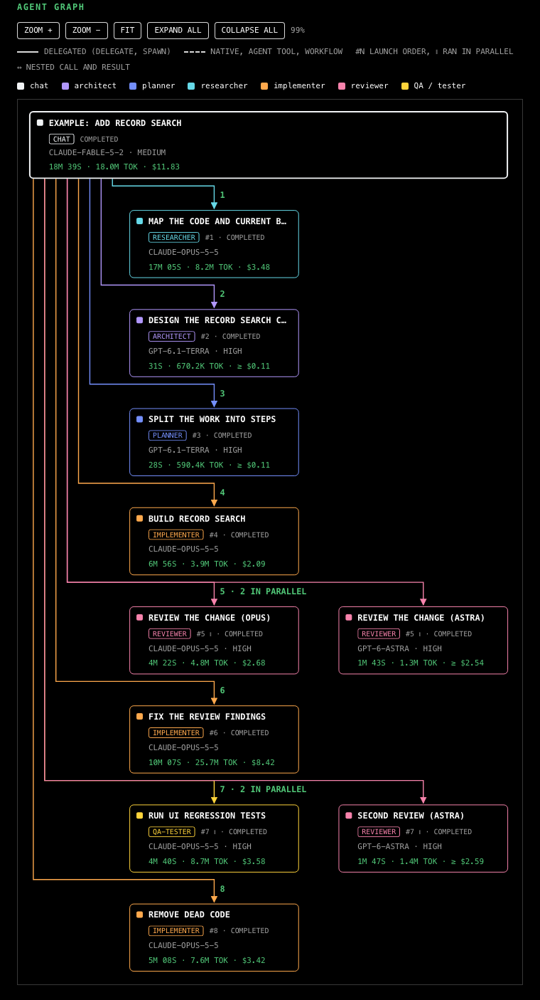

<div align="center">



# Dale

**Think, delegate, verify, and resume.**

Agent skills for Codex, Claude Code, and T3 Code: explore a direction, map a repository,
hand independent work to bounded subagents, and check the result against evidence.


<a href="LICENSE"></a>


[Quick start](#quick-start) · [Skills](#skills) · [Dale Max](#dale-max) · [Dale Cross](#dale-cross) · [Team](#the-team) · [Harnesses](#harnesses) · [Routing](#model-routing) · [Reference](#repository-knowledge)

</div>

<br>

Dale is twelve skills that scale from a direct answer to a coordinated team of subagents.
Small work stays with the agent you are talking to. Substantial work is split into units with
explicit ownership, and nothing is called done without evidence.

- 🧠 **Think** one-on-one with `dale-brainstorm`, or reframe a hard question with `dale-lenses`.
- 🗺️ **Understand** a repository with six evidence-backed documents from `dale-index`.
- 🤝 **Delegate** consequential work through `dale-max`, with independent review and a PASS/REVISE/REJECT/BLOCKED verdict.
- 🌐 **Mix models** across Claude, GPT, and Gemini with `dale-cross`, using a saved team from `dale-team`.
- ✅ **Verify** a technical claim with `dale-proof`, and **resume** with `dale-loop-pr` and `dale-loop-watch`.

## Quick start

### 1. Install

**Codex.** One line installs the `dale` binary from this repository's releases; `dale` then opens
the skill picker:

```sh
curl -fsSL https://renkas.pp.ua/dale-install.sh | sh
dale
```

Or build it from source:

```sh
git clone https://github.com/drenkas/dale.git
cd dale
cargo install --path tui
dale
```

**Claude Code.** Link the skills from a clone of this repository. The links point at the clone,
so pulling it updates the skills:

```sh
git clone https://github.com/drenkas/dale.git
cd dale
mkdir -p ~/.claude/skills
for s in skills/dale-*; do ln -s "$PWD/$s" ~/.claude/skills/; done
```

**T3 Code.** T3 Code runs an agent such as Codex or Claude Code and uses the skills that agent has,
so install for that agent.

> [!NOTE]
> `dale` manages the Codex copy only: it installs skills into `$CODEX_HOME/skills` (default
> `~/.codex/skills`) or updates an existing plugin install. Restart Codex after installing or
> updating. It does not manage the Claude Code links.

### 2. Save your team

Tell Dale once which model runs each role. Max and Cross read the answer from
`~/.agents/dale/team.json` on every run:

```text
$dale-team  Set up my Dale team: choose a model for each role.
```

### 3. Run something

Name a skill in your request, or let the agent pick one that fits the task. Codex writes
`$dale-max`; Claude Code writes `/dale-max`.

```text
# Codex
$dale-brainstorm  Brainstorm this idea with me one-on-one.
$dale-max         Run this consequential task through Dale Max.

# Claude Code
/dale-index       Index this repository with Dale.
/dale-cross       Coordinate this task across models with my saved team.
```

### Update

```sh
dale update --yes
dale list --json
```

`dale update` follows this repository's `main`.

<details>
<summary><b>Install and update details</b></summary>

<br>

The updater supports plugin-cache and standalone skill installations and preserves the previous
plugin version for rollback. Headless options and the installer implementation are documented in
[tui/README.md](tui/README.md). Updating skills does not require replacing your global
`AGENTS.md`; [codex/AGENTS.md](codex/AGENTS.md) holds the global Codex guidance that accompanies
the skills. Keep one canonical installed copy.

</details>

## Skills

Each skill is independently installable. Its local references belong to that skill and do not
require another Dale skill.

### 🧠 Think and explore

| Skill | What it does |
|---|---|
| [`dale-brainstorm`](skills/dale-brainstorm/SKILL.md) | Explore ideas and tradeoffs in conversation. Converge or implement only when asked. |
| [`dale-lenses`](skills/dale-lenses/SKILL.md) | Reframe a bounded hard question with one falsifiable lens: causal, systems, temporal, conservation, invert, constraint, contradiction, or decide. |

### 🗺️ Know your project and your workflow

| Skill | What it does |
|---|---|
| [`dale-index`](skills/dale-index/SKILL.md) | Create or incrementally refresh six repository knowledge primitives. |
| [`dale-coach`](skills/dale-coach/SKILL.md) | Read your recent agent history and suggest evidence-backed workflow improvements. |
| [`dale-trace`](skills/dale-trace/SKILL.md) | Draw one chat's agent tree with models, roles, time, tokens, and an API-price estimate. |

### 🤝 Orchestrate

| Skill | What it does |
|---|---|
| [`dale-max`](skills/dale-max/SKILL.md) | Complete consequential work through bounded subagents, independent review, and evidence-based acceptance. |
| [`dale-cross`](skills/dale-cross/SKILL.md) | Coordinate Claude, GPT, and Gemini subagents through T3 Code, with the team's model for each role. |
| [`dale-team`](skills/dale-team/SKILL.md) | Show, create, or change the saved team: which model runs each role. |

### ✅ Verify and present

| Skill | What it does |
|---|---|
| [`dale-proof`](skills/dale-proof/SKILL.md) | Verify a technical claim against direct, fresh evidence within an explicit boundary. |
| [`dale-visualize`](skills/dale-visualize/SKILL.md) | Create a self-contained HTML explanation or interactive artifact when layout or interaction clarifies more than prose. |

### 🔁 Monitor and resume

| Skill | What it does |
|---|---|
| [`dale-loop-pr`](skills/dale-loop-pr/SKILL.md) | Monitor or repair one existing pull request within the requested scope. |
| [`dale-loop-watch`](skills/dale-loop-watch/SKILL.md) | Notify or act when a source changes in a way you defined. |

<details>
<summary><b>Three of them at a glance</b></summary>

<br>

<table>
<tr>
<td align="center" width="33%"><br><sub><b>Lenses</b>: one primary lens, at most one challenge</sub></td>
<td align="center" width="33%"><br><sub><b>Proof</b>: the verdict is no stronger than the evidence</sub></td>
<td align="center" width="33%"><br><sub><b>Index</b>: a full run with discovery, verification, and six files</sub></td>
</tr>
</table>

</details>

## How Dale decides who does the work

Dale uses the calling agent and subagents by default. Delegate when a work unit can progress
independently and saves time or supplies meaningful independent evidence. Small or tightly coupled
work usually stays local.

| Need | Execution |
|---|---|
| Small or sequential work outside Max and Cross | The calling agent |
| Substantial work in Max or Cross, or independent implementation or evidence elsewhere | Bounded subagents |
| Requested future observation or continuation | Product automation with durable state |

In `dale-max` and `dale-cross` the coordinator is the planner and orchestrator. It sizes each unit
and does it itself when briefing, waiting for, and checking a child would cost more than the work.

Each worker has an observable output, minimal inputs, a read/write boundary, and an evidence
requirement.

## Dale Max

Max is for consequential work where a wrong result is costly and independent verification is worth
its price. The coordinator owns decomposition, dependencies, integration, and the final gate.



| Outcome | Meaning |
|---|---|
| **PASS** | Material criteria have direct evidence and independent review is complete. |
| **REVISE** | A concrete bounded correction could satisfy the failed criteria. |
| **REJECT** | The approach cannot credibly satisfy the outcome. |
| **BLOCKED** | Required input, authority, independence, or evidence is inaccessible. |

If independent review is unavailable, useful work continues, but Max reports the independence gate
as unavailable and does not issue a final PASS. A review arranged by the maker of the artifact is
not independent.

**Writers can share a checkout** when they cannot conflict:

- each has an exclusive write scope stated in its contract;
- shared files such as lockfiles, generated output, and common configuration have one owner;
- workers leave Git state alone;
- acceptance evidence is taken after every writer of the affected area finishes.

Writers whose scopes overlap run in sequence, or in separate worktrees from one commit. The
coordinator then integrates one coherent change before review. Uncommitted changes do not reach a
worktree; if a child needs them, Max tells you instead of committing or dropping them.

**Delegation may nest.** A child may hand part of its unit to its own child when its contract allows
it, for example an architect sending source reading to a researcher. A nested child takes the route
of its own role, never its parent's model or effort, and stays inside its parent's authority and
write scope. A unit is not complete while any descendant is running.

<details>
<summary><b>The worker contract</b></summary>

<br>

Every delegated unit carries these fields ([contracts.md](skills/dale-max/references/contracts.md)):

| Field | Content |
|---|---|
| Outcome and criteria | The observable result |
| Inputs | Sanitized request, exact source references, failed criteria |
| Target | Checkout, revision, or runtime |
| Read scope / Write scope | Sources it may read; exclusive paths it may write, or none |
| Delegation | None, or what it may hand to which role and model |
| Authority and constraints | Current user and repository instructions |
| Evidence required | Direct checks |
| Stop | Complete, disproven, or a concrete blocker |

Independent reviewers are read-only. They get the original requirement, the raw candidate with its
identity, and the available evidence, and they try to falsify the criterion without being told the
maker's verdict. A reviewer role with several models runs on all of them.

</details>

## Dale Cross

Cross takes the same orchestration across providers. It proposes only the roles the task needs and
takes their models from the saved team. For a role the team leaves open it discovers the executable
models in T3 Code's live catalog, asks you to choose before dispatch, then offers to save the result
as the team. Current-generation choices follow the available catalog rather than a fixed model list.

- Your choices override automatic Dale routes for that task. An unavailable selection needs a new
  choice, never a substitute.
- Cross-provider execution requires T3 Code's child-task support. Native subagents alone do not
  establish it.
- Cross runs alone, or supplies the routes for a Max workflow. It does not invoke Max by itself.

## The team

The team is your saved answer to "which model runs which role". It is one global file, the same in
every harness:

```text
~/.agents/dale/team.json
```

There is no per-project team. `dale-team` shows, creates, and edits it; `dale-max` and `dale-cross`
read it. A role may list **one to three models**. With several, the same brief runs on each one for
independent perspectives, and the report says where they agree and disagree.



A target that the current harness cannot run is never replaced by a similar one. Dale asks for a
replacement for this run, or for leave to continue without it. The target stays in the file for the
harness that can run it.

<details>
<summary><b>Team file format</b></summary>

<br>

An example with two Codex roles and a reviewer that runs on two models:

```json
{
  "version": 1,
  "roles": [
    {
      "role": "architect",
      "description": "Plans the approach, decomposes work, and makes design decisions.",
      "targets": [{ "provider": "codex", "model": "gpt-6.2-astra" }]
    },
    {
      "role": "implementer",
      "description": "Writes the change.",
      "targets": [{ "provider": "codex", "model": "gpt-6.1-terra" }]
    },
    {
      "role": "reviewer",
      "description": "Independently inspects the result, read-only.",
      "targets": [
        { "provider": "codex", "model": "gpt-6.2-astra" },
        { "provider": "claudeAgent", "model": "claude-opus-5-5" }
      ]
    }
  ]
}
```

| Field | Meaning |
|---|---|
| `role` | A unique name. The usual roles are `architect`, `researcher`, `implementer`, and `reviewer`; you may name others. |
| `description` | One sentence on what the role does. Work units are matched to roles by it. |
| `targets` | One to three models. The first is the role's model; more than one means the role runs on each. |
| `model` | The full model ID, never a harness alias such as `opus`. |
| `provider` | Who runs the model, because one model ID can be offered by more than one provider. |
| `options` | Only settings you picked, under the names the saving harness uses. |

| Harness | Can run | `provider` to store |
|---|---|---|
| T3 Code | Every provider instance that can run a child task | Its `providerInstanceId` |
| Claude Code | Claude models, through `Agent` | `claudeAgent` |
| Codex | GPT models, through `spawn_agent` | `codex` |

Claude Code and Codex use T3's default instance names, so a team saved in one harness reads in
another. A missing file means there is no team. A malformed file, or one with an unknown `version`,
is reported and treated as no team; Dale does not repair or guess. Dale writes the file only when you
ask or accept an offer to save, shows the complete team first, and stores no secrets.
Full rules: [team.md](skills/dale-max/references/team.md).

</details>

## Harnesses

Dale runs in three harnesses. [transport.md](skills/dale-max/references/transport.md) describes each;
where a live tool description differs, the live schema wins.

| | Codex | Claude Code | T3 Code |
|---|---|---|---|
| Delegation tool | `spawn_agent` | `Agent` | `delegate_task` |
| Models it can run | GPT models | Claude models | Every provider instance that can run a child task |
| Model and effort | Pass `model` and `reasoning_effort` explicitly with fresh context | Set `model` and `effort` on the call | Pass `target` with `providerInstanceId` and `model`, plus supported `options` |
| Nesting | Decided by the spawn tool | Up to three layers below the main conversation by default | Not specified |
| Separate checkout | Run conflicting writers in sequence when the tool offers none | `isolation: "worktree"`, branched from the default branch; name the base commit in the brief | `isolation: "worktree"`, from the parent's local commit |
| Waiting and limits | Respect the cap on open subagent threads | A background subagent notifies the parent | `mode: "async"`; completion wakes the parent |
| Coach reads | Codex task history | Session files under `~/.claude/projects/` | T3 Code threads |
| Trace reads | Codex state database and rollouts | Session and subagent transcripts | T3 Code state database, plus Claude transcripts for Claude's native subagents and workflow agents |
| Cross-provider work | No | No | **Yes** |

In every harness, a child that may delegate must be told so in its brief. Claude, GPT, and Gemini in
one workflow need T3 Code. Dale never silently substitutes another model when the selected route
cannot run; the work is reported blocked instead.

## Model routing

The saved team decides each role's model. The tables below apply when the team leaves a role out, or
for skills that route on their own. Explicit user settings take priority, and the live dispatch
schema decides which models, efforts, and context modes are supported. The routed skills (Max,
Cross, Brainstorm, Index, and Coach) show a workload-specific routing reason before dispatch and
never inherit a model or elevated effort merely because the coordinator or a parent uses it. Other
direct work and loop workers inherit their settings unless an explicit route is requested.

<details>
<summary><b>Routes and model IDs</b></summary>

<br>

**Max fallback**, for roles the team does not cover:

| Route | Model ID | Thinking | Used for |
|---|---|---|---|
| Terra standard | `gpt-6.1-terra` | `high` | Research, mechanical extraction, narrow checks |
| Terra deep | `gpt-6.1-terra` | `high` or `max` | Implementation, debugging, integration |
| Astra | `gpt-6.2-astra` | `high` or `max` | Architecture, planning, independent review |
| Sol | `gpt-6.2-sol` | `high` | Consequential ambiguity, adversarial proof |

By role, the fallback is Astra for an architect or reviewer and Terra for a researcher or
implementer.

**Brainstorm, Index, and Coach**, written for Codex's `spawn_agent`:

| Skill | Route | Model ID | Thinking | Used for |
|---|---|---|---|---|
| Brainstorm, Index | Luna standard | `gpt-6-luna` | `high` | Bounded discovery and narrow checks |
| Brainstorm, Index | Luna deep | `gpt-6-luna` | `high` or `max` | Coupled work and ordinary verification |
| Brainstorm, Index | Sol | `gpt-6.2-sol` | `high` | Rare consequential ambiguity, difficult cross-layer synthesis |
| Coach | Coach worker | `gpt-6-luna` | `max` | Evidence-backed retrospectives |

**When the Max coordinator runs on Claude**, Max uses this catalog instead and never mixes the two
automatically:

| Route | Model ID | Replaces | Thinking |
|---|---|---|---|
| Sonnet standard | `claude-sonnet-5-5` | Terra standard | `medium` |
| Sonnet deep | `claude-sonnet-5-5` | Terra deep | `medium` or `high` |
| Opus | `claude-opus-5-5` | Astra and Sol | `medium` or `high` |

GPT `high` maps to Claude `medium`, and GPT `max` maps to Claude `high`, which is the Claude ceiling.
Coach workers run on `claude-sonnet-5-5` at `high` when the coordinator runs on Claude.

Routing rules: Max routes for correctness, difficulty, and consequence rather than cost. A nested
child gets the route of its own role. An ambiguous dispatch fails closed: Dale inspects what exists
and never starts the same work twice because a result is missing.

</details>

## Repository knowledge

`dale-index` completes or refreshes an established primitive directory in place, or starts a new set
in the repository root. It never creates a second competing set.

| File | Owns |
|---|---|
| `REQ.md` | Intent, scope, requirements, acceptance criteria |
| `CONTEXT.md` | Architecture, contracts, repository map, operations |
| `STATE.md` | Current work, blockers, risks, next actions |
| `TDD.md` | Actual test strategy, commands, quality gates, coverage gaps |
| `DESIGN.md` | Existing UI language and states, or explicit non-applicability |
| `DECISIONS.md` | Evidenced decisions, alternatives, consequences, and dates |

Evidence is labeled `verified`, `inferred`, `unknown`, or `stale`, and code, tests, schemas, and
runtime output outrank docs. An incremental refresh checks changed claims and affected consumers,
including uncommitted work. A missing baseline triggers broader inspection. Discovery is read-only;
the coordinator writes and checks the final documents. There is no mandatory worker count: a small
repository or a narrow refresh is indexed directly.

## Coach reads your history

`dale-coach` audits recent agent tasks and returns at most three evidence-backed changes to how you
work. It reads the history of the harness it runs in, always as conversation without tool outputs:

- **Codex**: task history through `list_threads` and `read_thread`.
- **T3 Code**: top-level threads through `t3_thread_list` and `t3_thread_read`.
- **Claude Code**: the session files under `~/.claude/projects/`.

Details: [history-sources.md](skills/dale-coach/references/history-sources.md). Coach never messages
a source task, changes its state, or edits your prompts, `AGENTS.md`, or settings unless you
separately ask.

## Trace a chat

`dale-trace` draws one chat and the agents it created as a single self-contained HTML page: a
graph of who called whom and in what order, a detailed tree, and totals. Each agent shows its
model, role, active time, tokens, and the API-price equivalent of those tokens.

```text
$dale-trace  Show this chat's agent graph with time, tokens, and API-price cost.
```

<p align="center">
  
</p>

How to read the graph:

- **Order**: the chat is the bar on top. Each row below it is one launch step, numbered `#1`,
  `#2`, and so on by start time. Agents that ran at the same time share a step and sit side by
  side, marked `∥`.
- **Nesting**: an agent's own subagents sit to its right, joined by a two-way arrow for the call
  and its result.
- **Color is the role**, the same in every chat: chat white, architect violet, planner blue,
  researcher cyan, implementer orange, reviewer pink, QA or tester yellow, workflow grey. Similar
  names map to one color (builder and coder are implementers, judge and auditor are reviewers).
  Any other role takes a spare color.
- **Line style**: a solid line is a delegated agent; a dashed one is a native subagent, agent
  tool, or workflow.

- **Sources**: T3 Code's state database, Claude Code's session and subagent transcripts, and
  Codex's state database and rollouts. All are opened read-only; prompts, results, and file paths
  are never exported. Details: [trace-sources.md](skills/dale-trace/references/trace-sources.md).
- **Price**: taken from T3 Code's rates file, or from `--prices FILE`. Without either, costs read
  `unknown` unless you ask for `--fetch-prices`. The figure is an estimate of list price, not your
  bill, and a figure marked "≥" is a lower bound.
- **Output**: `~/.agents/dale/traces/` by default, so your repositories stay clean. Python 3.9 or
  newer is required; unknown values stay `unknown` and are never shown as zero.

## Evidence and lifecycle

In Max, additional reviewers need a concrete uncovered risk. Review and testing stop when the
required evidence is sufficient, and changed artifacts invalidate affected evidence.

Proof distinguishes declared, implemented, exercised, integrated, and observed behavior. A worker's completion
message or green local checks alone do not prove a deployed or integrated result. Dale reports what
changed, decisive evidence, and limitations; full orchestration ledgers are available when requested.

Loop PR and Loop Watch persist source identities, actions, evidence, and next conditions. They
re-observe on wake and do not assume subagents survive between runs. Unchanged monitoring stays
quiet. Existing user authorization persists; the workflow does not invent authority for publication,
merge, deployment, or external messages.

`dale-visualize` defaults to a linked code walkthrough for code changes: source-scoped snippets,
rationale, and connected execution and data flow. Visualizations are checked in a browser; static
checks alone do not establish their runtime behavior.

## Fork and compatibility

Adapted from upstream commit
[`8c7068d`](https://github.com/lubluniky/dale/commit/8c7068d11c18e60e57e5c8a1b76524a9bf0d8c0d).
The fork keeps its established routes, including task-matched Luna and Sol routing for Brainstorm
evidence and Index, and Luna at `max` for Coach. Cross keeps user-selected per-role routes and does
not implicitly invoke Max.

## Validation

Validate skill frontmatter and references, then exercise realistic scenarios: small direct changes,
independent work with a shared contract, incremental indexing, unavailable review, monitoring-only
requests, and mid-run corrections. Compare correctness, rework, unnecessary questions, elapsed time,
and usage when available. Static validation alone does not establish speed or cost improvements.

## License

Dale is licensed under the [Mozilla Public License 2.0](LICENSE).
Bundled third-party examples retain their source license notices.
